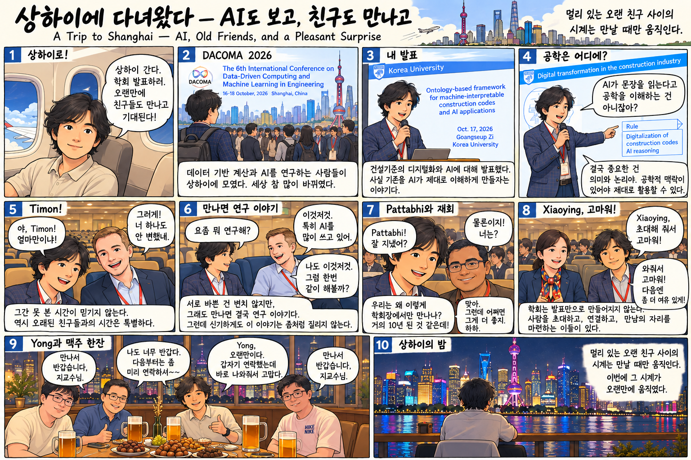

[English](index.qmd) | **한글**

{fig-alt="상하이 DACOMA 2026 학회 발표와 오랜 친구들과의 재회를 담은 열 컷 만화" width="100%"}

상하이에 학회 발표하러 갔다. 건설기준을 AI가 단순히 읽는 것을 넘어, 공학적 의미와 논리까지 이해하도록 만드는 이야기였다. 그런데 이번 출장에서 기억에 남는 건 발표만이 아니다. Timon, Pattabhi, Xiaoying, Yong까지 오랜 친구들을 만났다.

멀리 있는 오랜 친구 사이의 시계는 만날 때만 움직인다. 이번에는 상하이에서 오랜만에 움직였다.
