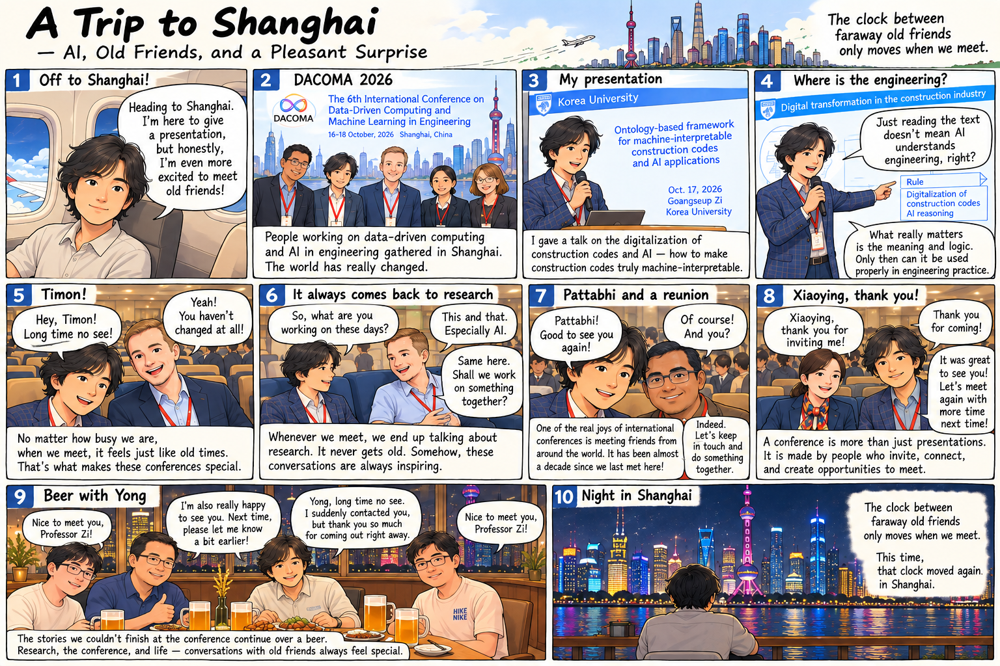

**English** | [한글](index-ko.qmd)

{fig-alt="Ten-panel illustrated diary about DACOMA 2026, AI and engineering, and reunions with friends in Shanghai" width="100%"}

A conference brought me to Shanghai. The presentation was about making construction codes understandable to AI—not merely readable as text, but interpretable in their engineering context. Just as memorable were the reunions with Timon, Pattabhi, Xiaoying, and Yong.

The clock between faraway old friends only moves when we meet. This time, it moved again in Shanghai.
