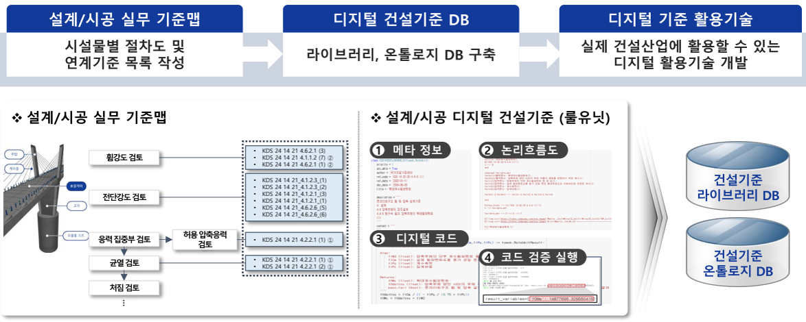
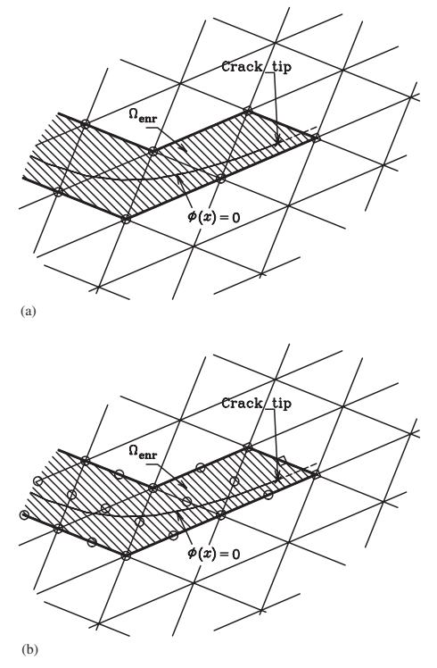
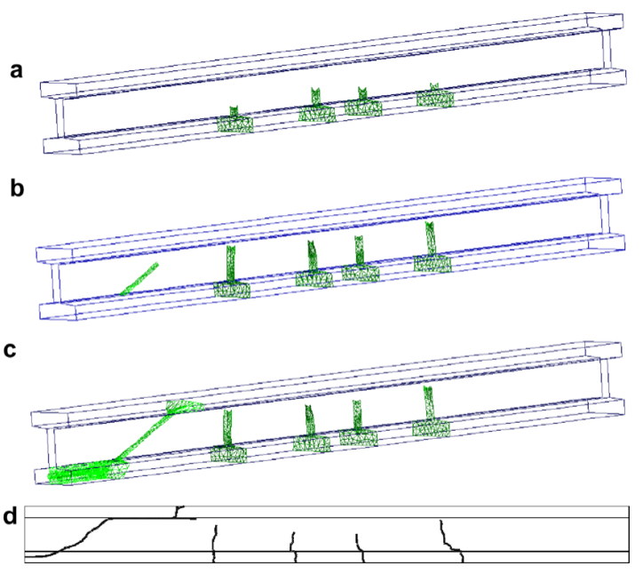
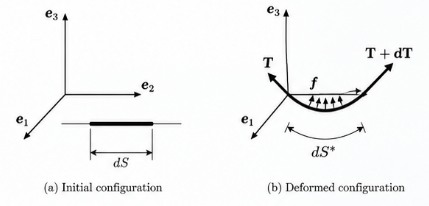
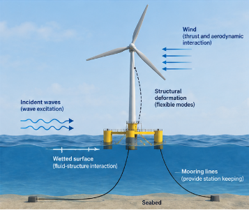

[English](index.qmd) | **한글**

연구 · 교육 · 역학 · 기술 글쓰기

이 사이트는 연구, 교육, 기술 커뮤니케이션을 통해 구조공학과 역학을 설명한다.

## 둘러보기

:::: {.grid .home-explore}

::: {.g-col-12 .g-col-md-6}
### [연구와 기술](research-ko.qmd)
:::

::: {.g-col-12 .g-col-md-6}
### [공학역학](mechanics-ko.qmd)
:::

::: {.g-col-12 .g-col-md-6}
### [공학 이야기](perspectives-ko.qmd)
:::

::: {.g-col-12 .g-col-md-6}
### [카툰 일기](cartoon-log-ko.qmd)
:::

::: {.g-col-12 .g-col-md-6}
### [공학 밖의 이야기](beyond-engineering-ko.qmd)
:::

::::

## Zi의 구조공학과 역학

### [힘·응력·변형률·변위는 어떻게 연결되는가? — Z 다이어그램](posts/z-diagram-introduction/index-ko.qmd)

Z Diagram은 이 사이트의 역학적 출발점이다. 힘, 응력, 변형률, 변위를 평형, 구성관계, 적합조건, 일과 에너지로 연결한다.

## 해상풍력

[해상풍력 연구와 기술 보기 →](research/offshore-wind-energy-ko.qmd)

2026-10-15 · 지광습

<a class="zi-home-title" href="posts/offshore-wind-legal-contract-vessel-finance/index-ko.qmd">해상풍력의 성공을 가로막는 보이지 않는 장벽: 법률, 계약 그리고 특수선박 금융</a>

해상풍력특별법, 해상풍력 건설계약, 해상풍력 설치선과 특수선박 금융의 문제를 구조공학과 해양건설의 관점에서 분석한다.

2026-10-15 · 지광습

<a class="zi-home-title" href="posts/offshore-wind-industrial-competitiveness/index-ko.qmd">해상풍력산업의 진정한 경쟁력은 어디에서 오는가?</a>

해상풍력 발전사업허가와 실제 설치용량의 격차, 발전단가 저감, 하부구조물 최적설계, 부유식 해상풍력과 산업 생태계의 과제를 분석한다.

2026-09-21 · 지광습

<a class="zi-home-title" href="posts/passive-fowt-motion-control/index-ko.qmd">부유식 해상풍력터빈의 운동을 패시브적으로 줄일 수 있을까?</a>

부유식 해상풍력터빈의 운동을 능동제어장치 없이 줄일 수 있는 이유를 동조액체감쇠기, 수평 스커트, 부유체 형상 최적화와 유탄성 응답을 통해 설명한다.

2026-09-13 · 지광습

<a class="zi-home-title" href="posts/offshore-wind-civil-engineering/index-ko.qmd">해상풍력은 왜 토목공학의 산업인가?</a>

해상풍력을 터빈만의 에너지 기술이 아니라 지반, 구조, 항만, 해상시공, 인증, 유지관리가 결합된 해양 인프라 시스템으로 인식하고 토목공학의 역할을 설명한다.

2026-09-02 · 지광습

<a class="zi-home-title" href="posts/nearshore-wave-energy/index-ko.qmd">연안의 파도 움직임을 어떻게 유용한 전력으로 바꿀 수 있을까?</a>

연안 진동암형 파력발전장치에서 파랑에 의한 국부 PTO 운동이 유압을 생성해서 전력으로 변환되는 과정을 역학적으로 설명한다.

2026-09-02 · 지광습

<a class="zi-home-title" href="posts/jacket-flexibility/index-ko.qmd">재킷지지 해상풍력터빈의 유연성은 실제로 어디에서 오는가?</a>

재킷지지 해상풍력터빈의 전체 강성은 부재의 EA와 EI만으로 결정되지 않는다. 트랜지션 피스의 하중 전달, 강관 접합부의 국부 변형, 말뚝-지반 상호작용이 고유진동수와 변위, 응력에 어떻게 영향을 주는지 살펴본다.

2026-08-30 · 지광습

<a class="zi-home-title" href="posts/biased-decision-making/index-ko.qmd">평가기준이 많으면 의사결정이 더 공정해질까?</a>

서로 상관된 평가기준이 다기준 공학 의사결정을 어떻게 편향시킬 수 있는지, 그리고 탐색적 요인분석과 AHP를 결합해 중복을 줄이는 원리를 설명한다.

## 디지털전환과 AI

[디지털전환과 AI 연구와 기술 보기 →](research/digital-transformation-ai-ko.qmd)

2026-09-29 · 지광습

<a class="zi-home-title" href="posts/civil-engineering-curriculum-2035/index-ko.qmd">토목공학은 무엇을 가르쳐야 하는가?</a>

토목공학 교육과정은 AI 시대에 어떻게 바뀌어야 할까? Civil Engineering의 역사, Engineering Science와 전문화의 발전, 토목공학과 건설공학의 차이, 그리고 AI·에너지·기후변화를 통합하는 미래 토목공학 커리큘럼을 살펴본다.

2026-09-26 · 지광습

<a class="zi-home-title" href="posts/why-wgd-needs-more-than-llm/index-ko.qmd">AI 시대에 건설기준을 디지털화한다는 것은 무엇인가?</a>

LLM의 작동 원리에서 RuleUnit, Ontology, Knowledge Graph와 WGD까지

2026-06-26 · 지광습

<a class="zi-home-title" href="posts/ai-construction-standards-without-hallucination/index-ko.qmd">건설 엔니지어링 실무에서 AI를 환각 없이 믿고 사용할 수 있을까?</a>

더 좋은 프롬프트보다, 더 필요한 것은 건설기준 지식의 구조화다

## 콘크리트와 재료

[콘크리트와 재료 연구와 기술 보기 →](research/concrete-materials-ko.qmd)

2026-09-22 · 지광습

<a class="zi-home-title" href="posts/age-adjusted-effective-modulus/index-ko.qmd">콘크리트에는 왜 재령보정 유효탄성계수가 필요한가?</a>

콘크리트 교량의 장기처짐을 계산할 때 왜 단순 유효탄성계수만으로는 부족할까? 크리프와 응력이완에서 출발해 재령보정 유효탄성계수법(AAEM)의 물리적 의미와 박스거더 교량 해석에서의 역할을 설명한다.

2026-09-03 · 지광습

<a class="zi-home-title" href="posts/coupled-concrete-durability/index-ko.qmd">콘크리트 내구성을 왜 하나의 열화 메커니즘만으로 설명할 수 없을까?</a>

염화물 침투, 탄산화, 철근부식, 알칼리-실리카 반응을 각각 따로 해석하면 왜 실제 콘크리트의 내구성을 놓칠 수 있는가? 물질이동, 화학반응, 미세구조 변화, 균열이 서로 되먹임하는 다중물리 문제로 콘크리트 내구성을 설명한다.

2026-09-02 · 지광습

<a class="zi-home-title" href="posts/reactive-waste-particle-size/index-ko.qmd">반응성 폐기물은 왜 입자크기에 따라 유해한 골재에서 유용한 재료로 바뀔까?</a>

폐유리와 BOF 슬래그 같은 반응성 폐기물은 왜 입자크기에 따라 콘크리트를 손상시키기도 하고 유용한 시멘트계 재료가 되기도 할까? ASR의 pessimum size, 파괴역학, 폐유리 분말과 BOF 슬래그의 입자크기 제어를 25년에 걸친 연구 흐름으로 설명한다.

2026-09-01 · 지광습

<a class="zi-home-title" href="posts/bof-slag-particle-size/index-ko.qmd">BOF 슬래그는 어느 정도까지 분쇄해야 콘크리트에 안전하게 사용할 수 있을까?</a>

BOF 슬래그(전로슬래그·제강슬래그)의 입자크기는 콘크리트와 시멘트계 재료의 팽창과 균열을 좌우한다. 유리 CaO, 임계 입자크기, 슬래그 혼입률과 분쇄에너지의 관계를 통해 BOF 슬래그를 어느 정도까지 분쇄해야 하는지 설명한다.

## 계산역학과 파괴

[계산역학과 파괴 연구와 기술 보기 →](research/computational-mechanics-fracture-ko.qmd)

2026-09-04 · 지광습

<a class="zi-home-title" href="posts/lessons-from-enriched-methods/index-ko.qmd">확충기법은 계산역학에 무엇을 남겼는가?</a>

XFEM과 XEFG에서 시작한 근사공간의 확충이라는 생각이 균열 표현, 독립적인 기하형상, 다양한 파괴 표현과 다중스케일 해석을 거치며 계산역학의 모델 설계 원리로 어떻게 확장되었는지를 설명한다.

2026-09-04 · 지광습

<a class="zi-home-title" href="posts/xefg-why-meshfree/index-ko.qmd">왜 XFEM을 무요소법으로 확장하는가?</a>

확장유한요소법(XFEM)의 근사공간 확충 개념을 왜 무요소법으로 확장했는지, XEFG의 영향영역, 점성균열, 균열선단 처리와 3차원 균열성장을 중심으로 설명한다.

2026-09-04 · 지광습

<a class="zi-home-title" href="posts/multiple-cracks-fracture-network/index-ko.qmd">여러 균열은 어떻게 분기하고 만나 파괴 네트워크를 만드는가?</a>

다중균열의 성장, 피로, 균열 상호작용, 합체, 분기, 접합과 3차원 파괴 네트워크의 위상 진화를 계산역학 관점에서 설명한다.

2026-09-04 · 지광습

<a class="zi-home-title" href="posts/how-much-physics-does-a-crack-need/index-ko.qmd">균열에는 얼마나 여러 종류의 물리적 요소가 필요한가?</a>

균열 주변의 작은 영역에만 상세한 파괴역학 물리적 요소를 배치하는 이유를 철근콘크리트, Arlequin 연속체 결합, 적응형 연속체-원자 다중스케일 해석과 그래핀 파괴를 통해 설명한다.

2026-09-04 · 지광습

<a class="zi-home-title" href="posts/alternative-crack-representations/index-ko.qmd">균열을 표현하려면 반드시 변위공간을 부가적으로 확충(enrichment)해야 하는가?</a>

재료가 연속적인 변형 특성을 잃고 불연속적인 균열이 생성되었다는 정보를 수치해석의 어디에 담을 것인가라는 질문을 중심으로 여러 파괴해석 기법을 역학적으로 비교한다.

2026-09-04 · 지광습

<a class="zi-home-title" href="posts/xfem-crack-through-mesh/index-ko.qmd">XFEM은 어떻게 균열이 요소망을 가로질러 지나가게 하는가?</a>

확장유한요소법(XFEM)이 단위의 분할과 근사공간의 확충을 이용하여 요소망을 다시 만들지 않고 변위 불연속, 점성균열, 균열선단, 동적 균열전파를 어떻게 표현하는지 설명한다.

2026-09-03 · 지광습

<a class="zi-home-title" href="posts/computational-fracture-overview/index-ko.qmd">계산 파괴역학은 왜 어려운가?</a>

균열 성장이 왜 수치적으로 어려운지, 그리고 확장유한요소법(XFEM)과 확장무요소법(XEFG)이 균열 기하와 배경 이산화를 분리하여 불연속과 균열 성장을 어떻게 표현하는지를 계산역학 관점에서 설명한다.

## 공학역학

[공학역학 글 보기 →](mechanics-ko.qmd)

2026-10-07 · 지광습

<a class="zi-home-title" href="posts/linear-elasticity/index-ko.qmd">등방성 선형탄성체에는 왜 재료상수가 두 개만 필요한가?</a>

등방성 선형탄성체에는 왜 독립적인 재료상수가 두 개만 필요한가? 체적변형과 형상변형에서 출발해 후크의 법칙, 4차 탄성 텐서, 보이트 표기법, 평면응력과 평면변형률 강성행렬까지 물리적으로 유도한다.

2026-09-22 · 지광습

<a class="zi-home-title" href="posts/age-adjusted-effective-modulus/index-ko.qmd">콘크리트에는 왜 재령보정 유효탄성계수가 필요한가?</a>

콘크리트 교량의 장기처짐을 계산할 때 왜 단순 유효탄성계수만으로는 부족할까? 크리프와 응력이완에서 출발해 재령보정 유효탄성계수법(AAEM)의 물리적 의미와 박스거더 교량 해석에서의 역할을 설명한다.

2026-09-04 · 지광습

<a class="zi-home-title" href="posts/mooring-line-dynamics/index-ko.qmd">계류선은 왜 단순한 비선형 스프링이 아닌가?</a>

시간영역에서 이해하는 계류선 동역학의 구조역학적 의미

2026-09-04 · 지광습

<a class="zi-home-title" href="posts/floating-structure-frequency-domain/index-ko.qmd">연성 부유식 구조물은 파랑에 어떻게 응답하는가?</a>

주파수영역에서 보면 구조물이 움직이는 순간, 주변 물도 동적 시스템의 일부가 된다

2026-09-02 · 지광습

<a class="zi-home-title" href="posts/stretchable-device-mechanics/index-ko.qmd">딱딱한 전자소자는 어떻게 늘어날 수 있을까?</a>

스트레처블 전자소자는 모든 부품을 늘어나게 만들어서 구현하는 것이 아니다. 좌굴, 강성 대비, 유연한 연결부와 변형률장 설계를 이용해 큰 전체 변형과 작은 국부 변형률을 동시에 만족시키는 역학을 설명한다.

2026-09-01 · 지광습

<a class="zi-home-title" href="posts/strain-tensor-energy/index-ko.qmd">변형률 텐서는 어디에서 나타나는가?</a>

왜 변형률은 변위구배의 대칭 부분일까? 표면력의 일에서 출발하여 평형, 가상일, 에너지 공액 관계를 통해 변형률 텐서가 자연스럽게 나타나는 과정을 설명한다.

2026-08-31 · 지광습

<a class="zi-home-title" href="posts/stress-tensor/index-ko.qmd">응력 텐서는 도대체 무엇인가?</a>

내부 절단면의 트랙션 벡터에서 출발하여 코시 응력 텐서, 코시 사면체, 임의 면의 수직응력과 전단응력, 코시 응력 공식을 물리적으로 설명한다.

2026-08-30 · 지광습

<a class="zi-home-title" href="posts/z-diagram-introduction/index-ko.qmd">힘·응력·변형률·변위는 어떻게 연결되는가? — Z 다이어그램</a>

2004년 역학 교육을 위해 개발한 역학문제 내비게이션 맵인 Z 다이어그램. 힘, 응력, 변형률, 변위를 평형, 구성관계, 적합조건, 일과 에너지로 연결한다.

